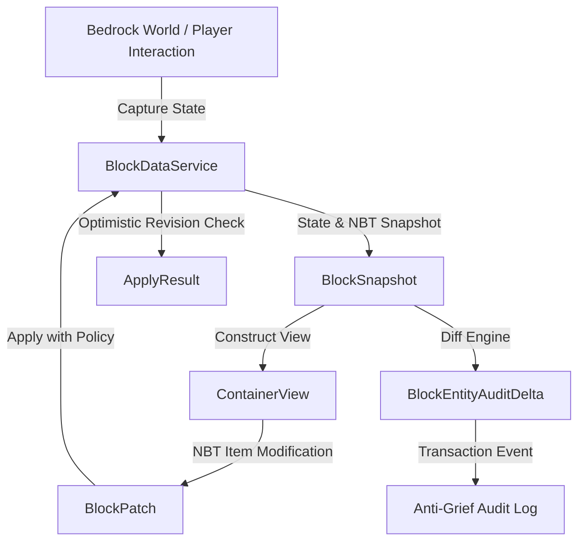

# Endstone BlockData API

## Endstone 0.11.16 update: v0.6.10

Detached block snapshots, canonical container NBT and native item/bundle writes for **Endstone 0.11.16**, **BDS 1.26.65.1 / runtime 26.65**, protocol **2225**, and **CPython 3.14** on Linux x86-64. The SDK is pinned to `23cb5758bdc070888cb89ecd1541ef25c4305b5c`. Native hooks require this exact binary pair; the public package dependency remains `endstone>=0.11.11`.

Linux native compilation and the complete-wheel disposable-server test passed. The test checks live block and named-container writes, nested item NBT, native bundle contents, stale revision rejection, dependent AntiGrief service access, and invalid NBT rejection, then verifies the container name and items after a full server restart. This update also fixes custom names being lost on restart by synchronizing the container and block-actor fields, enabling native name persistence, and reading the saved name instead of the default container label. The 89 Python tests and portable Linux/Windows C++ checks passed. Windows native binaries remain unqualified.

## Install

Download the complete `endstone_blockdata_inspector-0.6.10-cp314-cp314-linux_x86_64.whl` from [the stable release](https://github.com/TheNINJALLO/endstone-blockdata-api/releases/tag/v0.6.10). Stop the server, replace older inspector wheels and loose BlockData providers with this single wheel in `plugins/`, preserve plugin data, then restart. The wheel installs its matching native provider before dependent plugins load. The standalone `.so` is available for manual native-only installations.

Stable release: [v0.6.10](https://github.com/TheNINJALLO/endstone-blockdata-api/releases/tag/v0.6.10). See [build status](BUILD_STATUS.md), [update details](UPDATE_ENDSTONE_0.11.16.md), [runtime evidence](evidence/endstone-0.11.16/probe.json), and [the documentation index](docs/README.md). The previous release documentation is preserved [here](docs/history/endstone-0.11.15.md).

## 🏛️ Architecture Overview



---

## ⚡ Quickstart Code Examples

### Python API Example
```python
from endstone_blockdata import (
    BlockDataService,
    ContainerView,
    ConflictPolicy,
    LiveBlockDataAdapter,
)

# Inside an Endstone plugin, self.server is the live server instance.
service = BlockDataService(LiveBlockDataAdapter(self.server))

# 1. Capture block state & NBT snapshot
snapshot = service.capture("overworld", (100, 64, 200))
print(f"Block: {snapshot.type}, Revision: {snapshot.revision}")

# 2. Inspect & Modify Container NBT
if snapshot.block_entity:
    view = ContainerView(snapshot)
    # Insert custom item with NBT into slot 0
    patch = view.patch_item(0, {
        "Name": "minecraft:diamond_sword",
        "Count": 1,
        "tag": {"display": {"Name": "§6Excalibur"}}
    })
    result = service.apply(patch, ConflictPolicy.FAIL_IF_CHANGED)
    print(f"Apply Status: {result.status}")
```

### C++ API Example
```cpp
#include <endstone_blockdata/live_service.h>
#include <endstone/endstone.hpp>
#include <string>

void onContainerTouch(endstone::Server &server) {
    using namespace endstone_blockdata;
    auto service = server.getServiceManager().load<LiveBlockDataService>(
        std::string(BlockDataServiceName));
    if (!service) return;  // The native BlockData plugin is not enabled.

    BlockLocation location{"overworld", 100, 64, 200};
    auto snapshot = service->capture(location);
    if (!snapshot) return;

    BlockPatch patch;
    patch.location = location;
    patch.expected_revision = snapshot->revision;
    patch.state_updates["minecraft:cardinal_direction"] = std::string("north");
    auto result = service->apply(patch, ConflictPolicy::FailIfChanged);
    if (!result.ok()) {
        server.getLogger().warning("BlockData apply failed: {}", result.message);
    }
}
```

---

## In-game inspector (`/bd`)

The complete inspector wheel contains both its Python bridge and matching native provider. See [installation](docs/INSTALL.md).

### In-Game Command Reference
| Command | Usage | Description |
| :--- | :--- | :--- |
| `/bd` or `/bd menu` | `/bd menu` | Opens the guarded in-game menu with navigation for every command below. |
| `/bd locate [radius]` | `/bd locate 10` | Uses native region capture to find live container block entities. |
| `/bd inspect [x] [y] [z]` | `/bd inspect 100 64 200` | Displays state, revision, a bounded canonical-NBT preview, capacity, and occupied inventory. |
| `/bd item add <slot> <id> [cnt] [nbt]` | `/bd item add 0 diamond 64` | Writes a live item with optimistic revision checking. |
| `/bd item remove <slot>` | `/bd item remove 0` | Clears a live item with optimistic revision checking. |
| `/bd audit <start\|stop\|history>` | `/bd audit start` | Captures and compares live native snapshots. |
| `/bd state set <prop> <val>` | `/bd state set facing south` | Writes a live block-state property. |

The menu allows only one BlockData form per player, validates every submitted
field, and asks for confirmation before inventory or state writes. Closing a
submenu navigates back; disconnect, death, plugin shutdown, or form-send failure
releases its lock. Typed commands remain available, and the console receives the
text help because Bedrock forms are player-only.

---

## 📚 Documentation & Wiki

Full technical documentation, architecture deep dives, and API reference manuals are available in the project Wiki:

- 📖 [Documentation Index](docs/README.md)
- 🏗️ [Architecture & Memory Model](docs/ARCHITECTURE.md)
- 📦 [Canonical NBT & Container Systems](docs/nbt_and_containers.md)
- 🎒 [Bundle & Storage Item Module](docs/storage_items.md)
- 🛒 [Live Shelf API and Shop Example](docs/shelves.md)
- 🧍 [Player Inventory Adapter](docs/player_inventory.md)
- 🛡️ [Container Transaction Audit Engine](docs/audit_system.md)
- 📘 [Complete API Reference](docs/api_reference.md)
- 💡 [Code Examples & Recipes](examples/python/)

---

## 📜 License

Distributed under the [Apache License 2.0](LICENSE).

## Bundled provider

The inspector wheel now bundles and loads the matching native `blockdata_api` provider. Install that complete wheel by itself in `plugins/`; remove older loose BlockData libraries and inspector wheels while stopped. The deployment ZIP uses the same wheel. See [installation](docs/INSTALL.md). The standalone native library is an optional advanced artifact, not an additional dependency to copy alongside the bundle.
